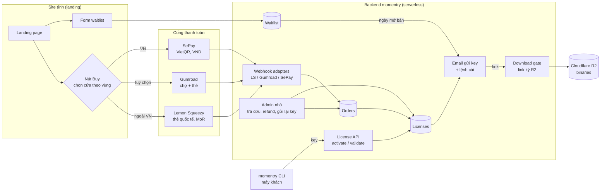
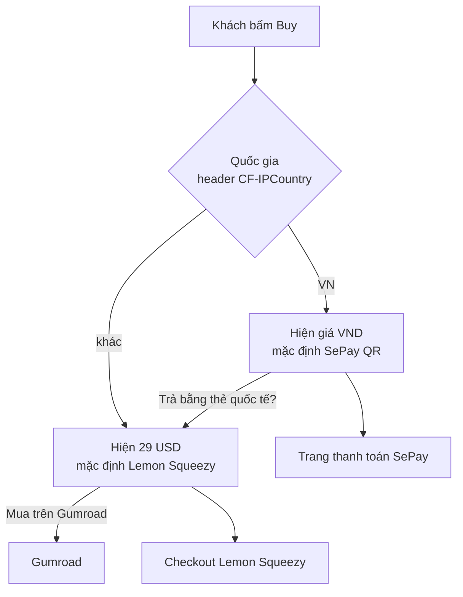
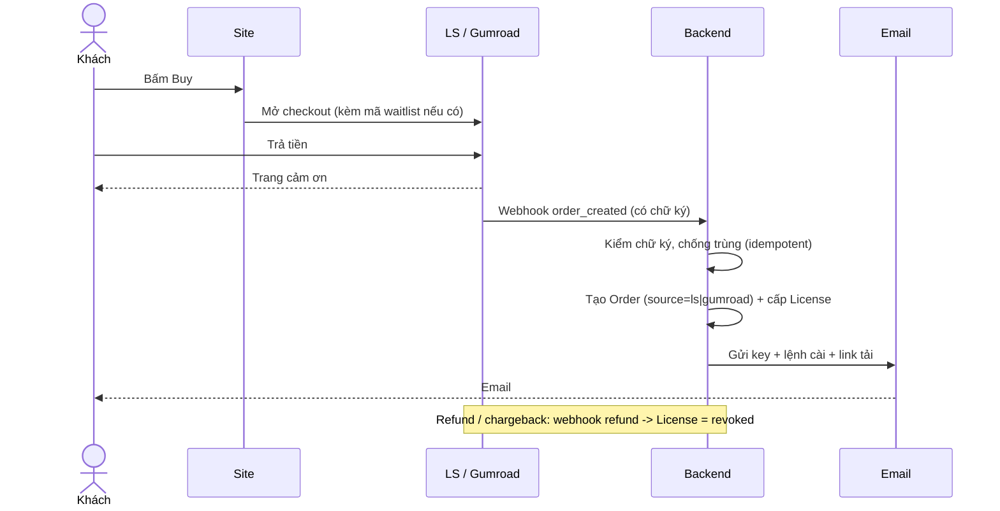
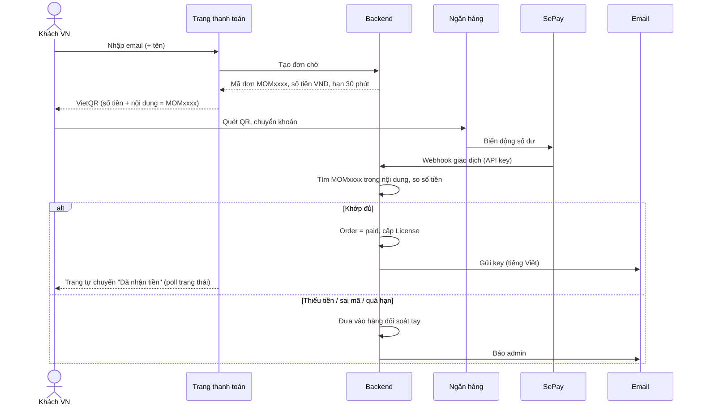
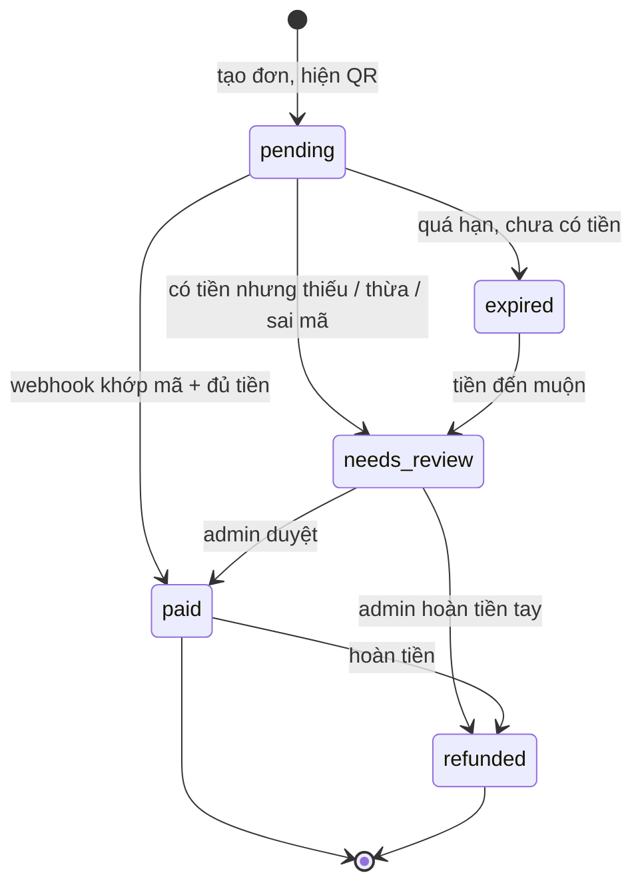
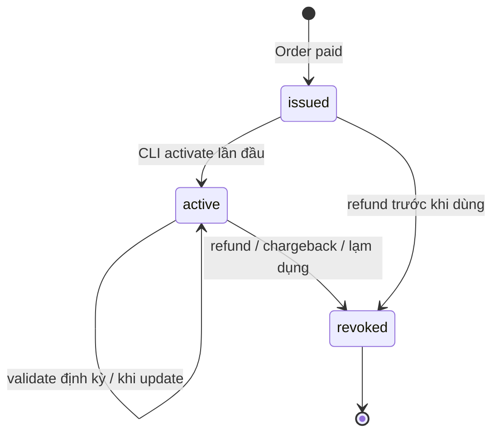
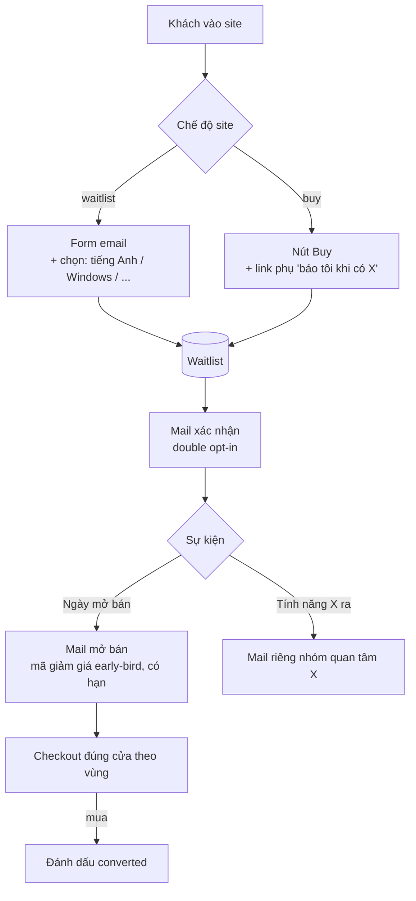
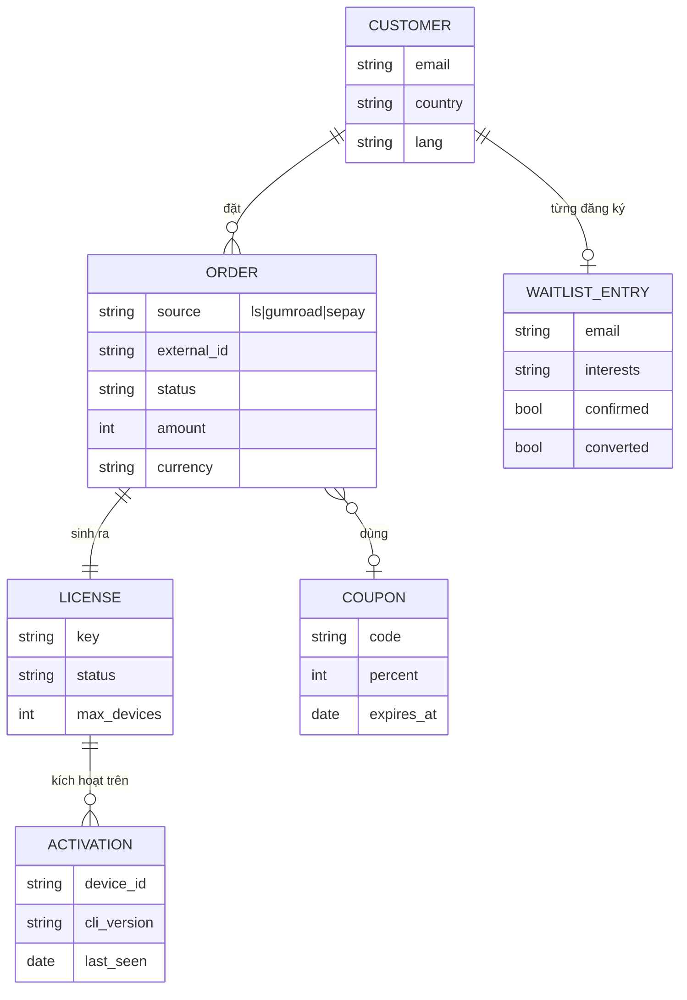
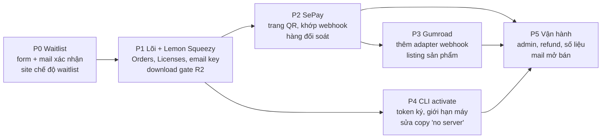

# Kế hoạch workflow bán hàng momentry (high-level)

Bản 0.1, 2026-11-07. Kế hoạch tầm cao, chưa phải spec code. Nối với [copy.md](copy.md) (biến `{{CHECKOUT_URL}}`, `{{DOWNLOAD_BASE}}`, `{{REFUND_POLICY}}`, `{{SUPPORT_EMAIL}}` còn trống) và [product-marketing.md](product-marketing.md) (giá 29 USD, license trọn đời, binary trên Cloudflare R2, "kiểm license nhẹ, chưa làm").

## 1. Mục tiêu

- Một sản phẩm, ba cửa bán: **Lemon Squeezy** (khách quốc tế, cửa chính trên site), **Gumroad** (cửa phụ, có sẵn chợ và người theo dõi), **SePay** (khách Việt, chuyển khoản VietQR, giá VND).
- Một nguồn sự thật cho license: dù mua ở đâu, khách nhận **cùng một dạng key**, CLI kiểm **một endpoint**.
- **Waitlist** chạy trước khi mở bán, và tiếp tục sau đó cho tính năng chưa có (truyện tiếng Anh, Windows...).
- Site vẫn tĩnh (`website/dist/index.html`). Phần động tách ra một backend nhỏ.

Ngoài phạm vi: affiliate, gói team, subscription, hoá đơn VAT tự động (ghi ở mục rủi ro).

## 2. Kiến trúc tổng

Ý chính: ba cổng thanh toán chỉ là **nguồn đơn hàng**. Webhook của từng cổng được chuẩn hoá thành một `Order` chung, rồi một chỗ duy nhất cấp license, gửi mail, mở quyền tải.

Gợi ý nền tảng: Cloudflare Worker + D1 (đã dùng R2, cùng nhà, rẻ, không cần server riêng). Email qua một dịch vụ transactional (Resend hoặc Postmark). Chưa chốt, quyết ở pha 1.

## 3. Chọn cửa bán theo khách

Vai trò mỗi cửa:

| Cửa | Cho ai | Vì sao giữ | Lưu ý |
|---|---|---|---|
| Lemon Squeezy | Khách quốc tế, mặc định | Merchant of Record: lo thuế VAT/GST toàn cầu thay mình | Kiểm lại trạng thái LS (đang gộp vào Stripe) trước khi khoá cửa chính |
| Gumroad | Người đã quen Gumroad, đến từ chợ / X | Kênh khám phá, có sẵn người theo dõi | Phí cao hơn LS. Không đặt làm nút chính |
| SePay | Khách Việt | Chuyển khoản ngân hàng quen thuộc, không cần thẻ quốc tế, giá VND | Mình tự lo thuế trong nước, đối soát chuyển khoản |

Giá VND: quyết riêng (ví dụ làm tròn từ 29 USD, hoặc giá địa phương thấp hơn). Thêm biến `{{PRICE_VND}}` vào copy khi chốt.

## 4. Luồng mua quốc tế (Lemon Squeezy / Gumroad)

Hai cổng giống nhau về hình dạng, chỉ khác adapter webhook.

Key: dùng **key của mình**, không dùng key có sẵn của LS/Gumroad. Lý do: một định dạng, một endpoint kiểm, đổi cổng không đụng CLI. Key cổng (nếu có) chỉ lưu tham chiếu trong `Order`.

## 5. Luồng mua cho khách Việt (SePay)

SePay không có trang checkout như LS. Nó báo về khi tài khoản ngân hàng nhận tiền. Nên mình tự làm trang "thanh toán": tạo đơn chờ, hiện QR có **mã đơn trong nội dung chuyển khoản**, khớp khi SePay báo.

Trạng thái đơn SePay:

Điểm cần nhớ:

- Webhook SePay có thể gửi lại: chống trùng theo mã giao dịch ngân hàng.
- Hoàn tiền SePay là **chuyển khoản tay**, admin ghi lại rồi revoke license.
- Trang thanh toán tiếng Việt (CLI và truyện cũng đang tiếng Việt, khớp tệp khách này).

## 6. License

Một bảng license chung cho mọi cửa. CLI kiểm nhẹ, đúng lời hứa trên copy ("activate with your key").

Nguyên tắc high-level:

- **Định dạng key**: chuỗi ngẫu nhiên đủ dài, có tiền tố dễ nhận (ví dụ `MOM-...`). Chi tiết để sau.
- **Giới hạn máy**: số máy kích hoạt tối đa (ví dụ 3), khách tự gỡ máy cũ. Con số chốt sau.
- **Kiểm offline được**: CLI giữ một token đã ký sau lần activate, chỉ gọi mạng khi activate, khi update, hoặc thưa (ví dụ mỗi vài tuần). Mất mạng không khoá người đã trả tiền.
- **Không gửi nội dung phiên**: lệnh gọi chỉ mang key + id máy + phiên bản. Phải sửa câu "no momentry server" trong [product-marketing.md](product-marketing.md) và [selling-points.md](selling-points.md) khi bật (đã ghi sẵn ở đó là phải kiểm lại).
- **Tải binary**: link R2 ký, có hạn, chỉ phát cho key còn hiệu lực. `{{DOWNLOAD_BASE}}` trỏ về download gate, không lộ bucket.

## 7. Waitlist

Hai việc: thu email trước ngày mở bán, và giữ người quan tâm tính năng chưa có.

- **Chế độ site** là một cờ build (`waitlist` / `buy`), không phải hai site.
- Mã early-bird phải dùng được ở **cả ba cửa**: tạo coupon trên LS và Gumroad, với SePay thì backend tự giảm số tiền khi tạo đơn.
- Đo: số đăng ký, tỉ lệ xác nhận, tỉ lệ mua sau mail mở bán (khớp email waitlist với `Order`).

## 8. Dữ liệu cốt lõi

Chỉ khung, chưa phải schema.

## 9. Lộ trình theo pha

| Pha | Xong khi | Phụ thuộc ngoài |
|---|---|---|
| P0 | Người lạ đăng ký được, nhận mail xác nhận | Domain, dịch vụ email |
| P1 | Mua thử trên LS (test mode) và nhận key + link tải chạy được | Tài khoản LS duyệt xong, EULA (board E10), `{{REFUND_POLICY}}` |
| P2 | Chuyển khoản thật 1 đơn nhỏ, nhận key tự động; 1 đơn sai mã vào hàng đối soát | Tài khoản SePay nối ngân hàng, giá VND |
| P3 | Mua thử trên Gumroad ra cùng dạng key | Tài khoản Gumroad |
| P4 | CLI từ chối key revoked, vẫn chạy khi mất mạng sau activate | P1 xong |
| P5 | Refund một đơn mỗi cửa thì key bị revoke; gửi lại key được từ admin | P1 đến P4 |

P1 bán được trước P4: khách có key và link tải, CLI chưa kiểm key cũng không sao lúc đầu (đúng với "light check, planned").

## 10. Rủi ro và câu hỏi còn mở

- **Lemon Squeezy đang chuyển sang Stripe**: kiểm điều khoản, phí, và việc nhận tiền về Việt Nam trước P1. Nếu vướng, Gumroad lên làm cửa chính, kiến trúc không đổi.
- **Thuế trong nước với đơn SePay**: doanh thu VND không có MoR đứng ra. Hỏi kế toán về hoá đơn điện tử và kê khai trước khi mở P2.
- **Giá VND** và **chính sách hoàn tiền** chưa chốt; cả hai cần trước khi mở bán.
- **Số máy mỗi key** và tần suất kiểm online: cân giữa chống chia sẻ key và lời hứa "không phiền người đã trả".
- **Copy cần sửa khi xong**: `{{CHECKOUT_URL}}` thành nút theo vùng, thêm `{{PRICE_VND}}`, câu về mạng trong mục privacy.
- **Một người vận hành**: hàng đối soát SePay và refund tay phải ít bước, có mail báo, không cần ngồi canh.
